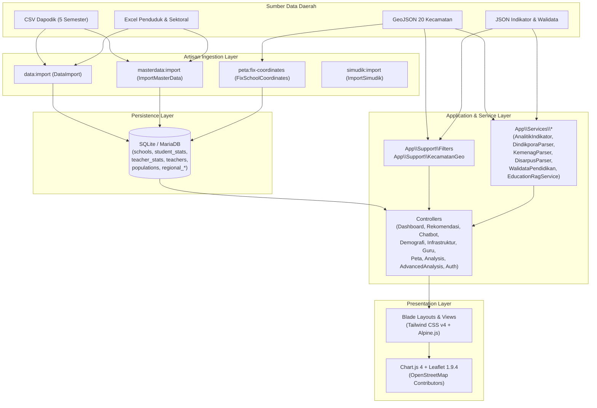

# Arsitektur Sistem — Dasbor Pendidikan Kabupaten Banjarnegara v2

## 1. Gambaran Umum Arsitektur
Dasbor Pendidikan Kabupaten Banjarnegara menggunakan arsitektur **Monolitik Modern berbasis Laravel 13.x** dengan pola **Pre-Aggregated Relational Analytics + Multi-Source Data Parser**. Seluruh data operasional sekolah (Dapodik 5 semester) dan kependudukan diimpor terlebih dahulu ke database relasional melalui CLI Artisan, sedangkan data pengaya lintas instansi (Dindikpora, Kemenag, Disarpus, BPS) diolah oleh lapisan *Service Parser* terdedikasi.



---

## 2. Struktur Direktori Utama
```text
dasbor-pendidikan-v2-main/
├── app/
│   ├── Console/Commands/
│   │   ├── DataImport.php            # Impor CSV Dapodik multi-semester & Excel populasi
│   │   ├── FixSchoolCoordinates.php  # Koreksi koordinat sekolah ke poligon GeoJSON kecamatan
│   │   ├── ImportMasterData.php      # Impor data pengaya Dindikpora, Kemenag, dan BPS
│   │   └── ImportSimudik.php         # Sinkronisasi direktori publik SIMU-DIK Banjarnegara
│   ├── Http/Controllers/
│   │   ├── AuthController.php             # Login, validasi sesi, dan logout
│   │   ├── DashboardController.php        # Ringkasan eksekutif (/)
│   │   ├── RekomendasiController.php      # Rekomendasi untuk Kepala Dinas (/rekomendasi)
│   │   ├── DemografiController.php        # Demografi siswa & usia sekolah (/demografi)
│   │   ├── InfrastrukturController.php    # Profil sekolah & akreditasi (/infrastruktur)
│   │   ├── GuruController.php             # Status kepegawaian & sertifikasi guru (/guru)
│   │   ├── PetaController.php             # Peta choropleth, heatmap & titik sekolah (/peta)
│   │   ├── AnalysisController.php         # 8 modul analisis kebijakan (/analisis/*)
│   │   ├── AdvancedAnalysisController.php # Analisis Kualitas Data, Sarana & Regrouping (/analisis/*)
│   │   └── ChatbotController.php          # Endpoint Hybrid RAG Chatbot (POST /chatbot/ask)
│   ├── Models/                       # Eloquent Models (School, StudentStat, TeacherStat, Teacher, Population, User)
│   ├── Services/                     # Parser, agregator & Hybrid RAG (EducationRagService, AnalitikIndikator, DindikporaParser, KemenagParser, DisarpusParser, WalidataPendidikan)
│   └── Support/                      # Helper filter global (Filters.php) & utilitas spasial (KecamatanGeo.php)
├── database/
│   ├── migrations/                   # 9 berkas migrasi skema tabel & indeks komposit
│   └── seeders/DatabaseSeeder.php    # Seeder akun administrator berbasis environment
├── public/
│   └── data/                         # Berkas GeoJSON batas kecamatan & JSON indikator makro
├── resources/
│   ├── css/app.css                   # Konfigurasi Tailwind CSS v4 (@theme)
│   └── views/
│       ├── layouts/app.blade.php     # Shell navigasi utama (Sidebar + Header)
│       ├── auth/login.blade.php      # Antarmuka login
│       └── dashboard/                # 13 view modul analitik & partial filter
└── routes/
    └── web.php                       # Definisi rute web dengan middleware guest & auth
```

---

## 3. Aliran Data Utama
1. **Ingesti Data (`php artisan data:import`):**
   - Membaca berkas CSV per semester dan lembar kerja Excel menggunakan `OpenSpout` dan stream reader.
   - Melakukan normalisasi nama kecamatan serta pemetaan ke tabel `schools` (`2.054` baris), `student_stats` (`10.069` baris), `teacher_stats` (`7.411` baris), `teachers` (`10.215` baris), dan `populations` (`20` kecamatan).
2. **Normalisasi Filter (`App\Support\Filters::fromRequest`):**
   - Setiap permintaan HTTP ke modul utama maupun analisis membaca query string `?semester=...&kecamatan=...&jenjang=...` dan mengembalikan state filter yang konsisten ke seluruh view.
3. **Penyajian Spasial (`PetaController` & `KecamatanGeo`):**
   - Menggabungkan poligon `banjarnegara_kecamatan.geojson` dengan agregat sekolah/siswa/guru per kecamatan untuk mewarnai layer choropleth serta merender marker koordinat sekolah di atas tile **OpenStreetMap Contributors** (`https://{s}.tile.openstreetmap.org/{z}/{x}/{y}.png`).

