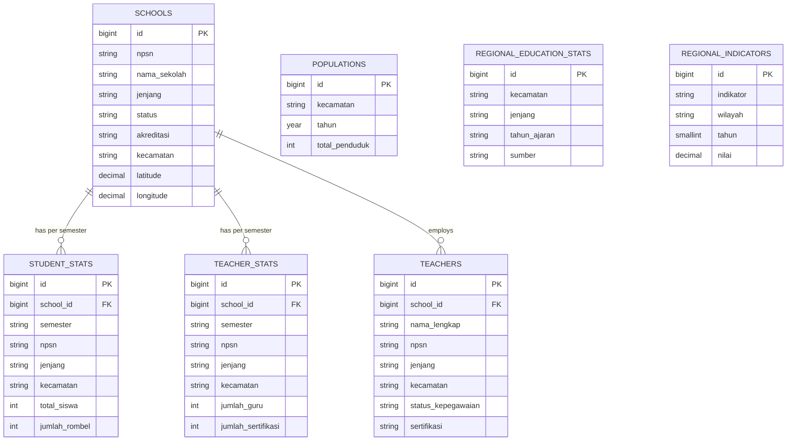

# Skema Database — Dasbor Pendidikan Kabupaten Banjarnegara v2

## 1. Diagram Relasi Entitas (ERD)

---

## 2. Spesifikasi Tabel Utama

### 2.1. `schools` (Master Satuan Pendidikan — 2.054 baris)
| Kolom | Tipe | Indeks / Constraint | Keterangan |
|---|---|---|---|
| `id` | `BIGINT UNSIGNED` | `PRIMARY KEY` | ID internal |
| `npsn` | `VARCHAR(255)` | `INDEX` | Nomor Pokok Sekolah Nasional |
| `nama_sekolah` | `VARCHAR(255)` | `NOT NULL` | Nama satuan pendidikan |
| `jenjang` | `VARCHAR(255)` | `INDEX (jenjang, status)` | `PAUD`, `TK`, `SD`, `SMP`, `SMA`, `SMK`, `MI`, `MTs`, `MA`, `PKBM` |
| `status` | `VARCHAR(255)` | `INDEX (jenjang, status)` | `Negeri` atau `Swasta` |
| `akreditasi` | `VARCHAR(255)` | `NULLABLE` | Peringkat akreditasi (`A`, `B`, `C`, `TT`, dll.) |
| `kecamatan` | `VARCHAR(255)` | `INDEX` | Nama kecamatan di Kabupaten Banjarnegara |
| `kode_wilayah` | `VARCHAR(20)` | `NULLABLE` | Kode wilayah Kemendagri/Dapodik |
| `alamat` | `TEXT` | `NULLABLE` | Alamat lengkap sekolah |
| `kepala_sekolah` | `VARCHAR(255)` | `NULLABLE` | Nama kepala sekolah |
| `telepon` | `VARCHAR(50)` | `NULLABLE` | Nomor kontak sekolah |
| `latitude` | `DECIMAL(10,7)` | `NULLABLE` | Koordinat lintang (tervalidasi di dalam poligon kecamatan) |
| `longitude` | `DECIMAL(10,7)` | `NULLABLE` | Koordinat bujur (tervalidasi di dalam poligon kecamatan) |
| `created_at` / `updated_at` | `TIMESTAMP` | `NULLABLE` | Waktu pencatatan |

### 2.2. `student_stats` (Statistik Siswa per Semester — 10.069 baris)
| Kolom | Tipe | Indeks / Constraint | Keterangan |
|---|---|---|---|
| `id` | `BIGINT UNSIGNED` | `PRIMARY KEY` | ID internal |
| `school_id` | `BIGINT UNSIGNED` | `FK -> schools.id (NULL ON DELETE)` | Relasi ke tabel `schools` |
| `semester` | `VARCHAR(10)` | `UNIQUE (semester, npsn)`, `INDEX` | Kode semester (mis. `20251`, `20242`) |
| `npsn` | `VARCHAR(20)` | `INDEX` | NPSN sekolah |
| `nama_sekolah` | `VARCHAR(255)` | `NOT NULL` | Nama sekolah |
| `jenjang` | `VARCHAR(255)` | `INDEX (semester, jenjang)` | Jenjang sekolah |
| `kecamatan` | `VARCHAR(255)` | `INDEX (semester, kecamatan)` | Kecamatan sekolah |
| `total_siswa` | `INT` | `DEFAULT 0` | Total peserta didik |
| `total_laki` / `total_perempuan` | `INT` | `DEFAULT 0` | Jumlah siswa laki-laki dan perempuan |
| `usia_sesuai` | `INT` | `DEFAULT 0` | Siswa dengan usia sesuai jenjang (`usia_sesuai_laki`, `usia_sesuai_perempuan`) |
| `usia_5_6`, `usia_7_12`, `usia_13_15`, `usia_16_18` | `INT` | `DEFAULT 0` | Distribusi kelompok usia sekolah |
| `jumlah_rombel` | `INT` | `DEFAULT 0` | Jumlah rombongan belajar aktif |

### 2.3. `teacher_stats` (Rekapitulasi Guru per Sekolah per Semester — 7.411 baris)
| Kolom | Tipe | Indeks / Constraint | Keterangan |
|---|---|---|---|
| `id` | `BIGINT UNSIGNED` | `PRIMARY KEY` | ID internal |
| `school_id` | `BIGINT UNSIGNED` | `FK -> schools.id (NULL ON DELETE)` | Relasi ke tabel `schools` |
| `semester` | `VARCHAR(10)` | `UNIQUE (semester, npsn)`, `INDEX` | Kode semester |
| `npsn` | `VARCHAR(20)` | `INDEX` | NPSN sekolah |
| `jenjang` / `kecamatan` | `VARCHAR(255)` | `INDEX` | Jenjang & kecamatan |
| `jumlah_guru` | `INT` | `DEFAULT 0` | Total guru di satuan pendidikan |
| `jumlah_sertifikasi` | `INT` | `DEFAULT 0` | Guru bersertifikat pendidik |
| `jumlah_pns`, `jumlah_pppk`, `jumlah_gty`, `jumlah_gtt`, `jumlah_honor` | `INT` | `DEFAULT 0` | Komposisi status kepegawaian |

### 2.4. `teachers` (Direktori Individu Pendidik — 10.215 baris)
- Menyimpan data pendidik individu (`school_id`, `nama_lengkap`, `nip`, `nuptk`, `jenis_kelamin`, `npsn`, `satuan_pendidikan`, `jenjang`, `kecamatan`, `status_kepegawaian`, `sertifikasi`, `bidang_studi`) dengan indeks pada `npsn`, `jenjang`, `kecamatan`, dan `status_kepegawaian`.

### 2.5. `populations` (Populasi Usia Sekolah per Kecamatan — 20 baris)
- Menyimpan proyeksi jumlah penduduk kelompok usia sekolah per kecamatan (`u04_l/p/t`, `u56_l/p/t`, `u712_l/p/t`, `u1315_l/p/t`, `u1618_l/p/t`, `u18_t`, `total_penduduk`) dengan constraint unik `(kecamatan, tahun)`.

### 2.6. `regional_education_stats` & `regional_indicators`
- `regional_education_stats`: Rekapitulasi sekolah/guru/murid negeri & swasta lintas tahun ajaran dari sumber `dindikpora` dan `kemenag` (`UNIQUE (kecamatan, jenjang, tahun_ajaran, sumber)`).
- `regional_indicators`: Indikator makro tingkat kabupaten dari BPS seperti `HLS`, `RLS`, `IPM`, `APK`, dan `APM` (`UNIQUE (indikator, wilayah, tahun)`).

---

## 3. Dinamika Kueri Analitik & Ekstensibilitas Data RAG

Untuk mendukung pembaruan data berkelanjutan di masa depan tanpa mengubah kode logika aplikasi:
1. **Deteksi Semester Aktif Otomatis:**
   - Mesin analitik dan RAG menentukan semester mutakhir secara dinamis melalui kueri agregasi `DB::table('student_stats')->max('semester')`.
   - Jika semester baru diimpor (misalnya `20262` atau `20271`), sistem langsung menggunakan data terbaru tersebut sebagai konteks acuan dasar (*active baseline*).
2. **Kueri Agregasi Bebas Hardcode:**
   - Agregasi statistik sekolah per kecamatan, jenjang, status akreditasi (`schools.akreditasi`), dan komposisi kepegawaian guru (`teacher_stats`) dikalkulasi langsung melalui kueri SQL relasional dengan indeks komposit.
   - Hasil kueri diformat menggunakan `number_format()` dinamis sehingga penambahan sekolah, rombel, maupun guru baru otomatis tercermin pada jawaban analitik Asisten Data.

