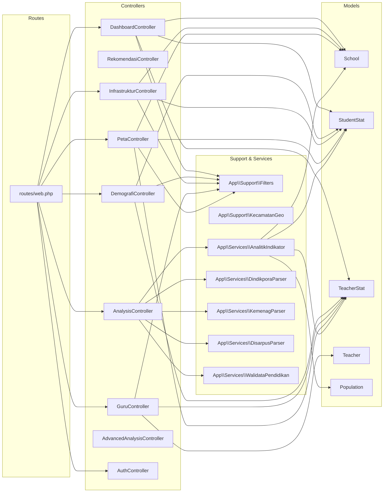

# Peta Ketergantungan Berkas (Dependency Graph) — Dasbor Pendidikan Banjarnegara v2

## 1. Diagram Ketergantungan Modul

---

## 2. Klasifikasi Dampak Berkas

### 🔴 Critical Files (Perubahan berdampak ke seluruh aplikasi)
| Berkas | Konsumen Langsung | Risiko Perubahan |
|---|---|---|
| `resources/views/layouts/app.blade.php` | Seluruh 13 halaman dasbor & analisis | Perubahan struktur navigasi, header `Referrer-Policy`, atau CDN Chart.js/Leaflet berdampak ke seluruh halaman |
| `app/Support/Filters.php` | `DashboardController`, `DemografiController`, `InfrastrukturController`, `GuruController`, `PetaController`, `partials/filters.blade.php` | Mengatur daftar semester, normalisasi parameter filter, dan daftar kecamatan/jenjang |
| `routes/web.php` | Seluruh tautan sidebar (`route('...')`) di `layouts/app.blade.php` | Mengubah nama rute akan memutus navigasi sidebar |
| `app/Services/AnalitikIndikator.php` | `AnalysisController` (6 dari 8 halaman analisis) | Menyediakan perhitungan indikator makro, tren, dan skor rekomendasi kebijakan |

### 🟡 High-Impact Files (Perubahan berdampak pada satu modul penuh)
| Berkas | Konsumen Langsung | Fungsi Utama |
|---|---|---|
| `app/Http/Controllers/AnalysisController.php` | 8 view di `resources/views/dashboard/*` | Mengorkestrasi sub-menu analisis kebijakan `/analisis/*` |
| `app/Http/Controllers/AdvancedAnalysisController.php` | `RekomendasiController`, `data-health.blade.php`, `sarana.blade.php`, `regrouping.blade.php` | Menyediakan perhitungan bersama kualitas data, sarana, kandidat regrouping, serta konsumsi `RekomendasiController` |
| `app/Services/EducationRagService.php` | `ChatbotController` (`POST /chatbot/ask`), `partials/chatbot.blade.php` | Mesin Hybrid RAG (Online Gemini API + Offline Basis Data Lokal) untuk lingkup data pendidikan & penjelasan kekurangan data guru MI/MTs |
| `app/Support/KecamatanGeo.php` | `FixSchoolCoordinates.php`, `DataImport.php`, `ImportSimudik.php` | Validasi geometri poligon GeoJSON 20 kecamatan |
| `app/Console/Commands/DataImport.php` | Tabel `schools`, `student_stats`, `teacher_stats`, `teachers`, `populations` | Pipeline ETL data Dapodik & kependudukan |

### 🟢 Leaf Files (Perubahan terisolasi pada satu tampilan)
- `resources/views/dashboard/peta.blade.php`
- `resources/views/dashboard/rekomendasi.blade.php`
- `resources/views/dashboard/demografi.blade.php`
- `resources/views/dashboard/infrastruktur.blade.php`
- `resources/views/dashboard/guru.blade.php`
- `resources/views/dashboard/gap.blade.php`, `dropout.blade.php`, `literacy.blade.php`, `madrasah.blade.php`, `indikator.blade.php`, `paud.blade.php`, `walidata.blade.php`, `kebijakan.blade.php`, `data-health.blade.php`, `sarana.blade.php`, `regrouping.blade.php`

